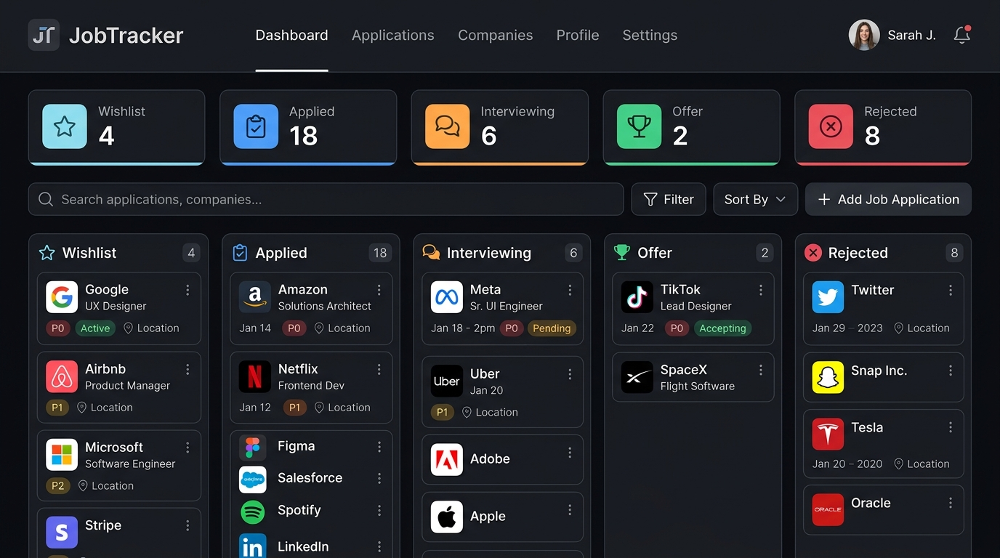

# 💼 JobTracker — Simple Job Application Tracker

A modern, fast, and simple web application to organize, track, and manage your job search pipeline.



---

## ✨ Features

- **📊 Metrics Dashboard**: Instant overview of your pipeline (Total, Wishlist, Applied, Interviewing, Offers, Rejected). Clicking any card filters the view immediately.
- **📋 Kanban Board View**: Drag and drop applications across recruitment stages (*Wishlist*, *Applied*, *Interviewing*, *Offer*, *Rejected*).
- **📝 Table / List View**: Clean, compact list view with all job details and one-click actions.
- **🔍 Instant Search & Filter**: Search across company, role, notes, recruiter contact, and location. Filter by stage and workplace type (Remote, Hybrid, On-site).
- **💾 Automatic Local Persistence**: All data is saved automatically in your browser's `localStorage` — no login, no accounts, and no data leaks.
- **📤 Export & Import**:
  - Export to **CSV** (for Excel, Google Sheets, or Notion).
  - Export to **JSON** (for full backups).
  - Import from **JSON** (to restore or transfer to another device).
- **🌓 Dark & Light Modes**: Beautiful themes with instant toggle and automatic system preference detection.
- **⌨️ Keyboard Shortcuts**:
  - `Ctrl + K` or `Cmd + K`: Focus search bar.
  - `N`: Quick-open "Add Application" dialog.
  - `Escape`: Close any open modal or dropdown.

---

## 🚀 How to Run

You have multiple easy ways to run this website:

### Option 1: Open directly in your browser (No installation required)
Just double-click **`index.html`** or right-click `index.html` → **Open With** → **Google Chrome / Edge / Firefox / Safari**.

### Option 2: Run with Node.js
```bash
npm start
# or
node server.js
```
Then open: **[http://localhost:3000](http://localhost:3000)**

### Option 3: Run with Python
```bash
python -m http.server 3000
```
Then open: **[http://localhost:3000](http://localhost:3000)**

---

## 📁 File Structure

```text
job-tracker/
├── index.html       # Semantic HTML layout and accessible modals
├── styles.css       # Responsive styling, CSS variables, dark/light theme
├── app.js           # Core state management, drag & drop, localStorage, export/import
├── server.js        # Lightweight zero-dependency static server
├── package.json     # Node script configuration
└── README.md        # Documentation and guide
```

---

## 🔒 Privacy

All your application data stays 100% on your device inside your browser's local storage. No tracking, no third-party telemetry, no cloud accounts needed.
